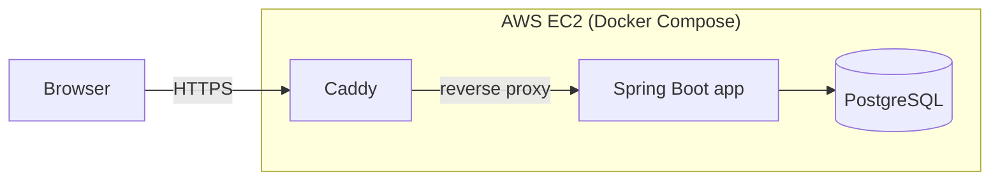
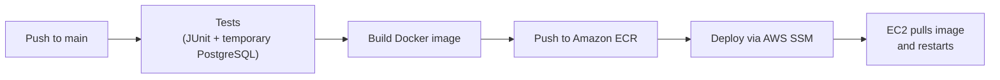

# CheckoutZone

An internal equipment checkout system: employees request laptops, cameras and other gear, managers approve and hand it out, and returns are tracked with condition notes.

[](https://github.com/aitzaz-qadir/checkout-zone/actions/workflows/ci.yml)

**Live demo:** https://99-79-19-16.sslip.io

<!-- Screenshots: save images to docs/screenshots/ and uncomment


-->

## Demo accounts

| Role | Username | Password |
|---|---|---|
| Employee | `jane.smith` | `password123` |
| Equipment manager | `bob.manager` | `password123` |

Demo data is shared by all visitors, so you may see other people's requests.

## Features

- **Checkout workflow:** request → approve or reject → hand out → return, enforced server-side
- **Role-based access:** employees request equipment; managers approve, hand out and process returns; admins manage users through the API
- **Equipment catalogue:** grid and list views, type filter, colour-coded status and condition
- **Dashboard:** live counts of available, checked-out and pending items
- **Overdue tracking:** overdue checkouts are flagged on the returns page
- **Light and dark themes**

## Tech stack

| Layer | Technology |
|---|---|
| Backend | Java 25, Spring Boot 4, Spring Data JPA (Hibernate), Spring Security |
| Database | PostgreSQL 18 |
| Frontend | Vanilla JavaScript (ES modules), Bootstrap 5 |
| Testing | JUnit, Mockito, Spring Boot Test |
| Containers | Docker (multi-stage build), Docker Compose, Caddy (automatic HTTPS) |
| Cloud | AWS EC2, ECR, IAM (OIDC federation), Systems Manager |
| CI/CD | GitHub Actions |

## Architecture



The backend follows a standard layered design: `controller` (REST endpoints) → `service` (business rules) → `repository` (Spring Data JPA) → `entity`. The frontend is a single page served as static files by the same app.

### CI/CD pipeline



- Every push and pull request runs the test suite against a throwaway PostgreSQL.
- On `main`, GitHub Actions builds the image, tags it with the commit SHA, pushes it to ECR, and tells the server to deploy that exact version.
- AWS setup (IAM policies, ECR lifecycle rule, deploy script) is versioned in [`infra/`](infra/).

## Security highlights

- **No stored cloud credentials:** GitHub Actions authenticates to AWS with OIDC and receives short-lived credentials for one role, restricted to this repo's `main` branch.
- **Least-privilege IAM:** the pipeline can only push to one ECR repository and run commands on one instance; the server can only pull images and talk to SSM.
- **SSH closed to the internet:** deploys go through Systems Manager, so port 22 only accepts the owner's IP.
- **Server-side identity:** the acting user always comes from the authenticated session, never from request bodies or URLs.
- **Safe registration:** a dedicated request DTO blocks role escalation and mass assignment.
- **Passwords:** BCrypt-hashed, never returned in API responses.
- **Secrets:** database and admin credentials come from environment variables, never from the repo.

## Running locally

**Prerequisites:** Java 25 and PostgreSQL (Maven is included via the wrapper).

```bash
git clone https://github.com/aitzaz-qadir/checkout-zone.git
cd checkout-zone
createdb -U postgres cz_data
./mvnw spring-boot:run        # Windows: .\mvnw.cmd spring-boot:run
```

Open http://localhost:8080. Demo users and equipment are seeded on startup. The local `dev` profile also enables SQL logging and `/test/*` workflow helpers.

**Tests:** `./mvnw test` (the context test needs the database running; the service unit tests don't).

**Configuration:** database and admin settings are read from environment variables with local defaults. See [`.env.example`](.env.example) for production settings.

## Project structure

```
src/main/java/com/checkout/checkout_zone/
├── config/        # Security rules, demo data seeder
├── controller/    # REST endpoints
├── service/       # Business rules (checkout workflow)
├── repository/    # Spring Data JPA repositories
└── entity/        # JPA entities and enums
src/main/resources/static/   # Frontend (HTML, CSS, JS modules)
infra/                       # AWS policies and deploy script
.github/workflows/           # CI/CD pipeline
```

## Roadmap

- JWT authentication to replace HTTP Basic (credentials are currently kept in browser storage, mitigated by HTTPS)
- Frontend rendering hardening
- Database migrations with Flyway instead of Hibernate auto-update
- Overdue reminder emails using a serverless pipeline (EventBridge, Lambda, SQS, SES, DynamoDB)
- Admin page for managing users and roles

## Author

**Aitzaz Qadir**

- Portfolio: [aitzaz-qadir.netlify.app](https://aitzaz-qadir.netlify.app)
- GitHub: [@aitzaz-qadir](https://github.com/aitzaz-qadir)
- LinkedIn: [linkedin.com/in/aitzaz-qadir](https://www.linkedin.com/in/aitzaz-qadir/)
- Email: aitzazqk@gmail.com

This project is open source and available for educational purposes.
